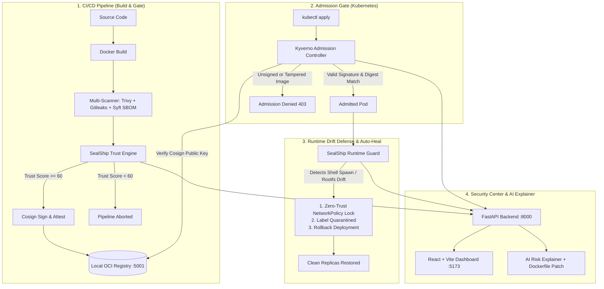

# ⚓ SealShip: Cloud Secure Container Delivery

> **"Proving that the container running in Kubernetes is exactly the image that was built, scanned, approved, and cryptographically signed—and actively neutralizing anything else."**

SealShip is a lightweight, local, end-to-end prototype designed for container supply chain security and runtime defense on Kubernetes. It guarantees cryptographic provenance, enforces zero-trust admission gating, monitors for runtime drift, and triggers automated rollbacks.

---

## 🏛️ Architecture



---

## ✨ Core Features

1. **Deterministic Supply Chain Pipeline (`pipeline/`):**
   - Secret scanning via Gitleaks
   - CVE vulnerability scanning via Trivy
   - Software Bill of Materials (SBOM) generation via Syft (CycloneDX format)
   - Cryptographic image signing and SBOM attestation via Cosign
   - Dynamic **Trust Score calculation (0-100)**: builds fail if the score falls below the configurable threshold.

2. **Strict Kubernetes Admission Gate (`k8s/kyverno/`):**
   - Kyverno `verifyImages` ClusterPolicy enforcing that only images cryptographically signed by SealShip's private key and from the approved registry are admitted.
   - Prevents tag-mutability attacks by validating digest signatures.

3. **Active Runtime Guard & Auto-Rollback (`runtime-guard/`):**
   - Watches for unauthorized interactive shell executions (`/bin/sh`, `bash`) and injected filesystem anomalies.
   - Instantly applies a zero-trust `quarantine-deny-all` `NetworkPolicy` to isolate the compromised pod.
   - Triggers `kubectl rollout undo` to restore the deployment to the last known-good signed digest and evicts the poisoned container.

4. **Security Center & AI Risk Explainer (`dashboard/` + `backend/`):**
   - React + Vite dark-mode dashboard displaying live chain-of-custody timelines (`Built` ➔ `Scanned` ➔ `Signed` ➔ `Admitted` ➔ `Active Watch`).
   - AI-powered vulnerability analysis (Gemini API with an embedded zero-latency deterministic fallback) providing plain-English risk assessments and one-click Dockerfile remediation patches.
   - Live telemetry feed of blocked deployments and runtime drift alerts.

---

## ⚡ Quick Start

### Prerequisites
- macOS (Apple Silicon or Intel) or Linux
- Docker (via Docker Desktop or Colima)
- Homebrew (for CLI tools: `kind`, `kubectl`, `cosign`)
- Node.js (v18+) and Python 3.11+

### 1-Click Bootstrap
```bash
./setup.sh
# or
make setup
```
This automatically:
- Starts the container runtime and local registry (`localhost:5001`)
- Provisions the Kind cluster with registry mirroring (`kind-sealship-cluster`)
- Installs Kyverno and applies the signature verification policy
- Starts the FastAPI backend daemon on `http://localhost:8000`
- Starts the Runtime Drift Guard
- Launches the React Dashboard on `http://localhost:5173`

---

## 🎬 3-Minute Demo Walkthrough

Run the guided, interactive presentation runner:
```bash
./demo.sh
# or
make demo
```

The script steps through each stage with prompts:

1. **Stage 1: Clean Build & Gated Pipeline**
   - Builds the demo application, runs Gitleaks + Trivy + Syft.
   - Evaluates the Trust Score (65/100).
   - Signs the image digest and attests the SBOM with Cosign.

2. **Stage 2: Admitted Deployment**
   - Deploys `demo-app` to the `sealship-demo` namespace.
   - Kyverno validates the Cosign signature against `cosign.pub` and admits the workload.

3. **Stage 3: Attack 1 — Unsigned Workload**
   - Pushes an unverified rogue image and attempts deployment.
   - **Result:** Kyverno admission webhook intercepts and denies the request (403 Forbidden).

4. **Stage 4: Attack 2 — Supply Chain Tampering**
   - Overwrites an existing approved tag with a backdoored image.
   - **Result:** Kyverno detects that the cryptographic signature does not match the tampered digest and blocks admission.

5. **Stage 5: Attack 3 — Runtime Intrusion & Container Drift**
   - Injects an unauthorized shell process and payload into the running container.
   - **Result:** Runtime Guard flags the intrusion within 2 seconds, isolates the pod with the `quarantine-deny-all` NetworkPolicy, automatically rolls back the deployment, and restores a healthy replica.

6. **Stage 6: Inspect the React Dashboard**
   - Open **`http://localhost:5173`** to view the live timeline, Trust Score badges, AI risk analysis, and event log.

---

## 📁 Repository Structure

```text
sealship/
├── Makefile                          # Unified build and demo targets
├── setup.sh                          # 1-click bootstrap script
├── demo.sh                           # Guided interactive presentation script
├── .env.example                      # Environment variables template
│
├── demo-app/                         # Target workload
│   ├── app.py                        # Minimal Flask service
│   ├── Dockerfile                    # Container configuration
│   └── requirements.txt
│
├── pipeline/                         # Deterministic Supply Chain Pipeline
│   ├── cosign.key                    # Cosign private key (local demo)
│   ├── cosign.pub                    # Cosign public key
│   ├── generate_keys.sh              # Keypair generation
│   ├── build.sh                      # Docker build
│   ├── scan.sh                       # Gitleaks, Trivy, and Syft multi-scan
│   ├── sign.sh                       # Cosign sign & SBOM attestation
│   ├── push.sh                       # Registry push
│   └── run_pipeline.sh               # Orchestrator with Trust Score gate
│
├── k8s/                              # Kubernetes Manifests
│   ├── kind-config.yaml              # Kind cluster with registry containerd patch
│   ├── registry.sh                   # Docker registry:2 container launcher
│   ├── create-cluster.sh             # Cluster creation & registry linking
│   ├── namespace.yaml                # 'sealship-demo' namespace
│   ├── network-policy-quarantine.yaml# Zero-trust quarantine policy
│   ├── deployment.yaml               # Target deployment manifest
│   └── kyverno/
│       ├── install.sh                # Kyverno installer & policy renderer
│       ├── cluster-policy.template.yaml
│       └── cluster-policy.yaml       # verifyImages enforcement policy
│
├── backend/                          # FastAPI Backend
│   ├── app/
│   │   ├── main.py                   # REST endpoints & CORS
│   │   ├── database.py               # SQLite storage
│   │   ├── models.py                 # Schemas & data models
│   │   ├── trust_score.py            # Transparent scoring engine
│   │   └── ai_explainer.py           # Gemini LLM + deterministic fallback
│   ├── requirements.txt
│   └── run.sh
│
├── runtime-guard/                    # Python Runtime Monitor
│   └── guard.py                      # Drift & shell detector with auto-rollback
│
├── dashboard/                        # Modern React + Vite Dashboard
│   ├── src/
│   │   ├── App.jsx                   # Dark-mode command center
│   │   └── index.css                 # Glassmorphic UI styles
│   ├── package.json
│   └── vite.config.js
│
└── attack/                           # Live attack simulations
    ├── attack_unsigned.sh            # Simulates raw unsigned deployment
    ├── attack_tampered.sh            # Simulates tag-hijacking supply chain attack
    └── attack_drift.sh               # Simulates runtime shell intrusion
```

---

## 🧹 Teardown

To shut down all background daemons and remove the Kind cluster:
```bash
make clean
```
